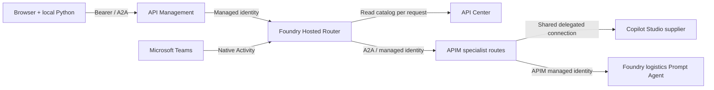

# Contoso Motors: Supplier–Buyer Agent Collaboration

A demonstration of a **Microsoft Foundry Hosted Router** coordinating a
**Copilot Studio supplier agent** and a **Foundry logistics Prompt Agent**.
Users ask questions through a local web application or Microsoft Teams.
Answers explain fictional delivery and returnable-packaging conditions, with
versioned source references. The agents do not approve purchases, verify stock
or book transport.

## Overview

[](docs/contoso-motors-architecture.svg)

The configured demo at a glance, with separate message, discovery and network
paths. [Open the vector diagram](docs/contoso-motors-architecture.svg) or
[download the editable source](docs/contoso-motors-architecture.excalidraw).
The step-by-step flow remains in [How the current demo works](#how-the-current-demo-works).

> **Read this first:** this revision includes the current Motors implementation,
> prompts, tests and sanitized binding examples. A clone can run offline checks;
> it does **not** provision a working cloud environment. Private connectivity,
> identities, Studio publication and consent require separate operator setup.
> See [current status and evidence boundaries](docs/status.md).

## Start here

| I want to… | Read |
|---|---|
| Follow Foundry → APIM → Copilot Studio in the code and configure it | [Guided implementation and setup path](docs/foundry-apim-studio.md) |
| Run the already configured local application | [Local setup and startup](docs/setup.md#local-application-setup) |
| Use the existing Teams app or try a demo question | [Demo walkthrough](docs/demo.md) |
| Understand the agents, network and identities | [Architecture and connectivity](docs/connectivity.md) |
| Operate the private deployment or update an agent | [Operator guide](docs/operations.md) |
| Know what is deployed, tested, missing or legacy | [Current status](docs/status.md) |
| Run local development checks | [Development checks](docs/setup.md#development-checks) |

### Already configured on this Windows computer?

Open PowerShell in the repository root:

```powershell
.\start-local.ps1 -CheckOnly
.\start-local.ps1
```

Keep that window open, visit **http://localhost:8000/**, and sign in with the
approved Microsoft account. Select a suggested question, review the draft and
send it. A suggestion does not send automatically in the current Motors UI.
Stop your server with **Ctrl+C**.

This starts the local application, not Azure resources. `npm run build` builds
the frontend but does not start it. Do not stop another process if port 8000 is
occupied. For a new computer, read the [source and environment boundaries](docs/status.md#source-availability)
and complete [setup](docs/setup.md) before running these commands.

## How the current demo works



API Center is the **catalog**, not a gateway. APIM is the **gateway and credential
boundary**. The Router classifies registered demo questions and discovers the
matching specialist through API Center. Teams enters the Router directly through
its native Activity endpoint, not through the local Python server.

The old Azure Function and its exclusive App Service plan have been removed
from the configured demo. APIM, Foundry, API Center, shared storage, monitoring
and networking remain. [Network and identity details](docs/connectivity.md)
explain which paths are public, private or delegated.

## What this example demonstrates

The fictional order is **500 interior trim sets due Friday**, with a supplier
proposal to deliver **300 Friday and 200 Monday**. The supplier explains written
acceptance conditions and evidence limits. Logistics explains receiving and
returning racks and boxes without inventing packaging counts or bookings.

The configured demo uses **scenario 3: a shared delegated Studio connection**.
Browser sign-in identifies the application user, not the identity of that shared
connection. Per-user Studio delegation and Studio service-to-service execution
are not enabled. This is a bounded demo, not an unrestricted assistant.

## Repository map

| Path | Purpose |
|---|---|
| `frontend/` | Browser UI, Microsoft sign-in and UI tests |
| `contoso_backend/` | Loopback Python server, user admission and requester |
| `contoso/router/` | Hosted routing, protocol adapters and tests |
| `contoso/providers/` | Downstream provider clients and response validation |
| `contoso/infra/` | Infrastructure references and APIM policies |
| `contoso/ops/` | Build and operational helpers |
| `contoso/publication/` | Retained **legacy Function publication worker** |
| `contoso-demo/` | Synthetic scenarios and versioned reference material |
| `docs/` | Usage, setup, architecture, operations and status |

The Motors runtime and operational helpers are included. Deployment bindings,
permissions, consent and cloud resources are deliberately not bundled.
The [availability matrix](docs/status.md#source-availability) separates source
availability from provisioning and live acceptance. Start with the guided path;
the retained multi-service `contoso/azure.yaml` is historical, not a shortcut
for deploying the current topology.

## Safety and scope

Use only authorized identities and explicitly selected Azure contexts. Keep
credentials, private keys, tokens, local configuration and raw operational
evidence out of Git. Never broaden access to make a demo pass.

Optional Azure Container Apps hosting is **not deployed**. The current entry
points are the local application and Teams. Production readiness, final local
UI revalidation and the remaining operational checks are tracked in
[known gaps](docs/status.md#known-gaps).

## License

The sample's original code and documentation are available under the
[MIT license](LICENSE). Microsoft product icons, trademarks and third-party
dependencies retain their own terms. See [third-party notices](THIRD_PARTY_NOTICES.md)
and [icon attribution](docs/icons/README.md).
