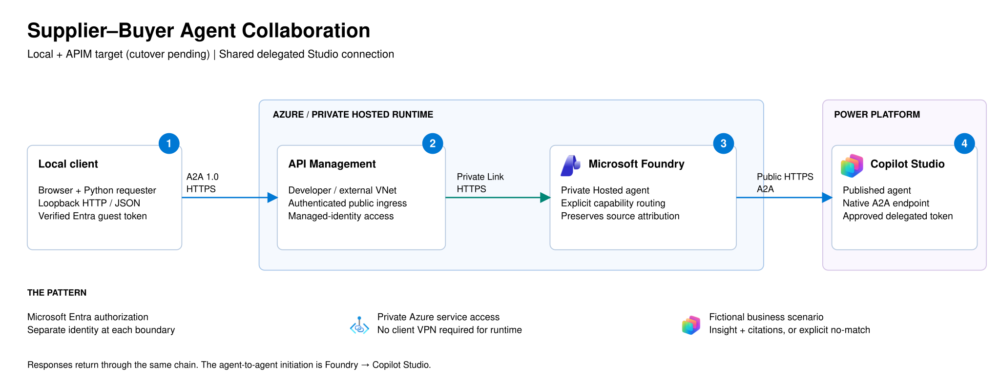
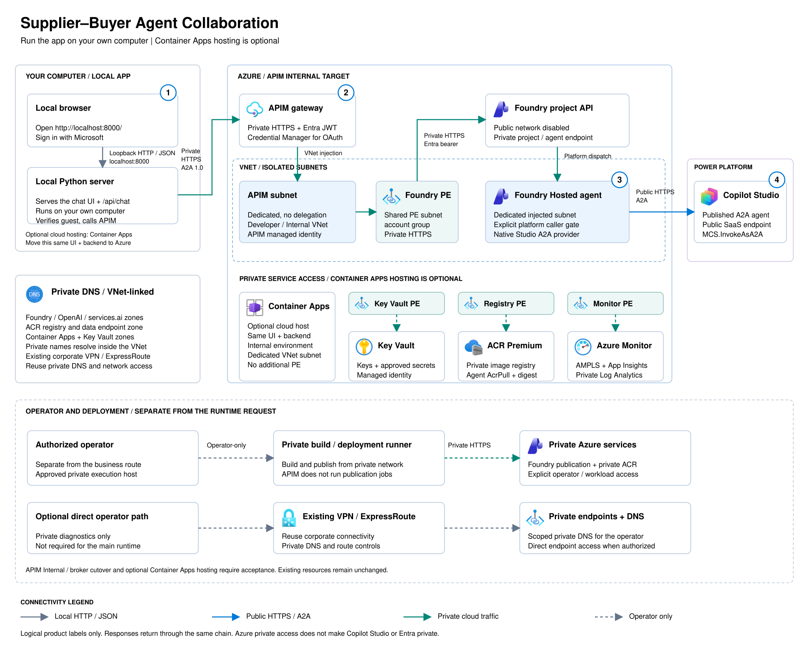

# Supplier–Buyer Agent Collaboration

A reference implementation that connects a private **Microsoft Foundry Hosted agent** to a published **Copilot Studio agent** through authenticated Agent-to-Agent (A2A) communication.

The Foundry agent routes registered questions to Copilot Studio, preserves source attribution, and returns an explicit no-match when the requested capability is not available. A fictional B2B supplier proposes 300 units Friday and 200 Monday against a buyer's request for 500 units Friday. Agents explain the buyer's conditions; they cannot approve a revised order or verify inventory.

The four [configured scenarios](contoso-demo/scenarios.json) cover proposal assessment, acceptance conditions and evidence limits, an unsupported penalty amount, and an approval request that must return no-match. The active source is [supplier delivery terms](contoso-demo/knowledge/supplier-delivery-terms.md), `CONTOSO-DEMO-SUPPLIER-001`, version 1. All business data is synthetic; local test responses are not live acceptance evidence.

## Architecture



Read the numbered stages from left to right: **1** approved client, **2** authenticated gateway, **3** private Foundry Hosted agent, **4** published Copilot Studio agent.

**Request path:** client → authenticated gateway → private Foundry Hosted agent → Copilot Studio A2A endpoint. Responses return through the same chain. An AWS Lambda requester is included only as an optional external-client example, not a requirement for the Foundry–Copilot Studio integration.

The optional browser frontend can be served locally. It is a client of the Lambda requester, not a locally hosted agent. The chat keeps the conversation prominent. Expand **Delivery proposal** for the synthetic context or **Connection settings** for explicit routing controls. Session actions appear after sign-in. Authentication and conversation data remain in page memory.

## Detailed connectivity



The detailed view uses the same four stage numbers. It separates public HTTPS, private VNet traffic, identity exchange, and optional operator connectivity, including subnet boundaries, Private Link, private DNS, storage, container registry, and monitoring.

[Connectivity guide](docs/connectivity.md) · [Setup guide](docs/setup.md) · [Overview PNG](docs/architecture-overview.png) · [Detailed PNG](docs/architecture.png)

Editable sources: [overview](docs/architecture-overview.excalidraw) and [detailed architecture](docs/architecture.excalidraw). Product icons follow [Microsoft's permitted architecture-icon usage](docs/icons/README.md).

## What's included

| Component | Location |
|---|---|
| Hosted runtime, explicit routing, A2A transport, and attribution | [`contoso/`](contoso/) |
| Authenticated gateway, delegated-token broker, and private publication worker | [`contoso/gateway/`](contoso/gateway/), [`contoso/connections/`](contoso/connections/), [`contoso/publication/`](contoso/publication/) |
| Private Azure infrastructure reference | [`contoso/infra/`](contoso/infra/) |
| Optional Lambda requester and authenticated browser client | [`contoso_backend/`](contoso_backend/), [`contoso-template.yaml`](contoso-template.yaml), [`frontend/`](frontend/) |
| Synthetic questions and source documents | [`contoso-demo/`](contoso-demo/) |

## Start here

Follow the [setup guide](docs/setup.md) for prerequisites, identity configuration, infrastructure, and publication. This is a reference sample with explicit deployment bindings, **not a one-command deployment**. No credentials, deployed resource identifiers, or operator history are included.

For local checks, use Python 3.12 and Node.js:

```powershell
python -m venv .venv
.\.venv\Scripts\python.exe -m pip install -r requirements-dev.txt
.\.venv\Scripts\python.exe -m pytest --import-mode=importlib contoso contoso_backend
npm ci
npm test
npm run test:ui
npm run build
```

## Scope

The demonstrated business route is Foundry → Copilot Studio A2A using delegated `MCS.InvokeAsA2A` authorization. Registered questions are matched explicitly, not through unrestricted autonomous planning. Contoso is a fictional scenario, not a platform dependency.

Additional knowledge and SDK adapters are retained as reference code, not claimed as accepted business routes. Teams, Microsoft 365 channels, Power Automate, and bidirectional A2A are not part of this sample. Preview APIs, regional availability, token consent, and upstream response-time limits require deployment-specific review.

To regenerate both editable diagrams and PNGs, run `node tools\render-diagrams.mjs --png` after installing dependencies and Playwright Chromium. The generator preserves numbered stages **1–4**, official icons, and rejects connector crossings. Diagram regeneration does not change VPN, DNS, or cloud resources.
