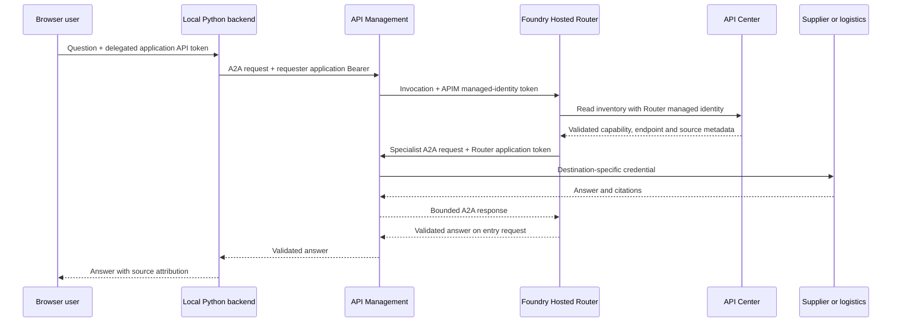
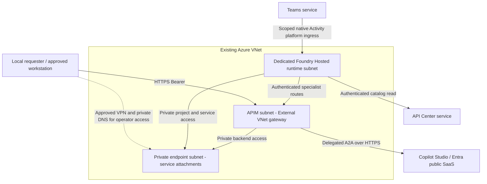

# Architecture and connectivity

[Home](../README.md) · [Setup](setup.md) · [Demo](demo.md) ·
[Operations](operations.md) · [Status](status.md)

This is the **configured Contoso Motors demo**, based on the latest recorded
acceptance on 2026-11-13. It is not a claim that a fresh clone reproduces it,
nor a new live Azure audit. See [source availability](status.md#source-availability).

For a product-icon view of the same scenario, open the
[Contoso Motors architecture overview](contoso-motors-architecture.svg).
The sequence and network views below provide complementary detail.

## Components and responsibilities

| Component | Responsibility | Does not do |
|---|---|---|
| Local browser and Python backend | Sign-in, approved-user admission, chat UI and confidential requester | Run an AI model locally or forward the browser token to Studio |
| Microsoft Teams | Native messaging entry to the Router | Depend on localhost or the retired Function |
| Foundry Hosted Router | Classify registered questions, discover a specialist and validate its answer | Approve purchases or choose arbitrary caller-supplied endpoints |
| API Center | Authenticated per-request inventory and routing metadata | Proxy messages, issue tokens or grant callers access |
| APIM | Enforce caller/schema limits and apply destination credentials | Execute the LLM or run private build/publication jobs |
| Copilot Studio supplier | Explain the synthetic delivery proposal and acceptance conditions | Verify inventory, invent penalties or approve changes |
| Foundry logistics Prompt Agent | Explain receiving and returnable-packaging coordination | Book transport or treat trim-set quantities as packaging counts |

## Request and credential flow

Teams replaces the first three steps with native Activity delivery into the
same Router business flow. Replies return through the M365 Agents SDK Connector.
The local Python process is not on the Teams path.

### The identities are different

| Boundary | Credential / admission |
|---|---|
| Browser → local API | Entra delegated token with exact tenant, audience, scope and approved user |
| Python → APIM entry API | Separate requester application identity. Current demo uses a certificate to obtain its Bearer token |
| APIM → Router | APIM managed identity and Router platform caller admission |
| Teams → Router | Foundry-verified request context, M365 endpoint authorization and a separate Teams caller allowlist |
| Router → API Center | Actual Router managed identity with catalog read permission |
| Router → APIM specialist routes | Actual Router application identity and the required application role |
| APIM → supplier | Shared delegated Studio connection managed by APIM Credential Manager |
| APIM → logistics | APIM managed-identity Foundry token, not a Studio token |

The certificate stays at the Python requester. APIM does **not** require mTLS.
Browser user identity is **not** propagated as per-user Studio delegation.
The delegated Studio token remains inside APIM, not in the browser or Router.
The shared connection's approved administrator owner is an isolated demo
exception, not the production recommendation.

## Network boundaries

The selected deployment uses **APIM Developer with External VNet mode**, not
the Internal mode shown in earlier diagrams. External mode provides a public
gateway endpoint while allowing VNet backend access. Endpoint reachability is
not authorization.

The Teams arrow represents platform dispatch, **not** a public listener added
to the Hosted subnet. Foundry's general public network access remains disabled.
Only the scoped native M365 Activity exposure is enabled. Preserve `Shared`
publication and `BotServiceRbac` together with the runtime's explicit caller
checks.

Foundry, registry, storage and monitoring are managed services. Their private
endpoint attachments are in the network, not the entire services. Approved
private DNS and connectivity are required for direct operator access to the
private project. Do not open Foundry public access to compensate for a local
VPN or DNS problem.

Studio, Entra and Teams include public service paths. This is **not** an
end-to-end private-only solution. Do not infer API Center network isolation
from its managed-identity authentication.

See Microsoft's [APIM External VNet guidance](https://learn.microsoft.com/azure/api-management/api-management-using-with-vnet),
[Foundry private connectivity](https://learn.microsoft.com/azure/foundry/how-to/configure-private-link)
and [native M365 publication with private projects](https://learn.microsoft.com/azure/foundry/agents/how-to/publish-copilot-virtual-network).

## Discovery and specialist routes

Every business request reads API Center using the Router identity. Registered
questions map to bounded capabilities. Inventory supplies the approved provider,
route version and source metadata. An unavailable or malformed managed catalog
fails explicitly, without a cached or static fallback. A valid catalog with
no compatible capability returns no-match without invoking a specialist.

| Specialist | Capability | APIM route | Source |
|---|---|---|---|
| Studio supplier | `supplier-delivery-terms` | `/agents/studio-copilot-harness/versions/1/a2a` | `CONTOSO-MOTORS-SUPPLIER-001`, version 1 |
| Foundry logistics | `knowledge-knowledge` | `/agents/motors-logistics/versions/1/a2a` | `CONTOSO-MOTORS-LOGISTICS-001`, version 1 |

The route's `versions/1` is the **published route contract**, not the active
Foundry agent version. At the recorded acceptance, Router version 20 and
logistics version 6 were selected. Source version 1 is another independent
identifier. Do not replace a Foundry selector with `1` because it appears in
an APIM URL.

The supplier reference is part of the Studio configuration. The logistics
reference is embedded in its prompt instructions, with no tools or RAG.
Catalog metadata describes sources, but is not evidence of document retrieval.
No SharePoint retrieval is claimed.

## Limits and response presentation

The current Router enforces a 65-second total budget. Teams accepts plain-text
questions, rejects unsupported attachments and reserves reply-delivery time
inside that same budget. The answer limit is 150 whitespace-separated words,
including headings and inline citations but excluding the separate attribution.
Oversized answers fail explicitly rather than being truncated.

Teams uses Markdown headings and a compact **References** footer. Each exact
source/provider/version group lists its title, version and source ID once,
followed by the cited sections. Inline citations remain intact. Missing or
inconsistent attribution is an error, not a silently omitted citation.

## Retired and optional components

The demo's legacy Function, its exclusive App Service plan and six exclusive
identity grants were removed with explicit owner approval. Shared storage,
APIM, Foundry, API Center, monitoring, DNS and networking were preserved.
Retired source files do not mean those services still run.

Azure Container Apps is only a possible future host for the same UI/Python
application. No such host was deployed. It requires separate packaging,
credentials, ingress, redirect, network and acceptance work.

The older `architecture*.svg`, `.png`, `.excalidraw` assets and their generator
are **historical Internal-APIM proposals**, not this deployed topology.
The current diagrams are maintained above and in the README.
