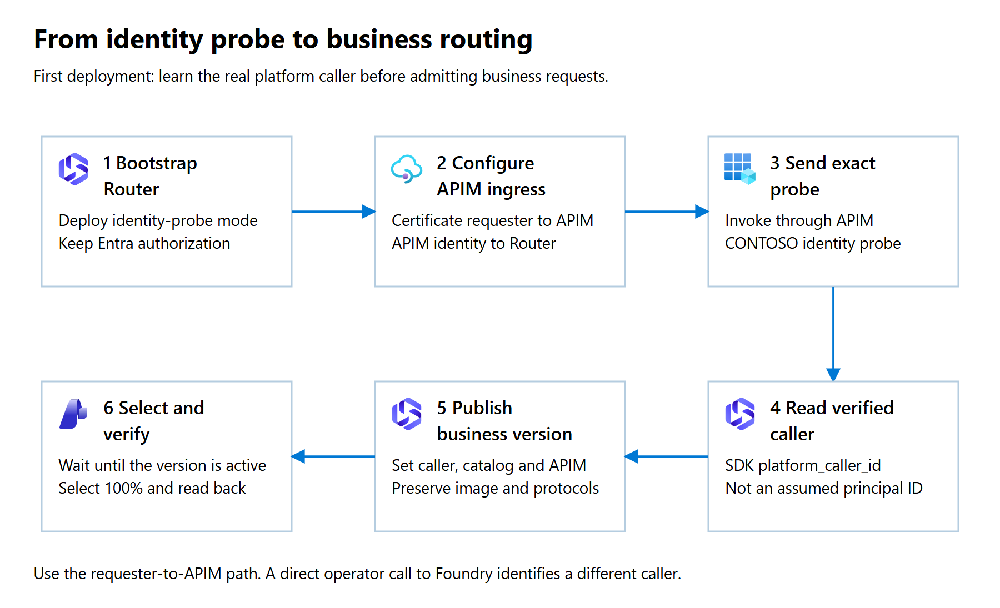

# Replicate the Contoso Motors demo

[Home](../README.md#start-here) · [Learn the A2A integration](foundry-apim-studio.md) ·
[Architecture](connectivity.md) · [Local setup](setup.md)

Use this guide to build your own instance of the demo. Start with the local
browser channel, connect both specialists, then add Teams if you want it.
Use your own tenant, subscription, resource names and Copilot Studio environment.

The setup combines Azure resource creation, Entra configuration, Studio's
publication/consent UI and repository templates. The numbered stages below are
the deployment order, not a single installer. Commands that deploy a template,
build an image or use `--apply` create or change resources and incur Azure usage.

## Before you begin

You need:

- An Azure subscription with permission to create resources and assign roles.
  Choose a region supporting Foundry Hosted agents and your logistics model.
- An Entra administrator who can create app registrations, assign application
  roles and approve the Studio delegated permission.
- A Copilot Studio environment with the **A2A client** publication channel and
  an appropriately licensed user who can publish and use the supplier agent.
  Use the same tenant as the Azure deployment for these sample policies.
- Windows, PowerShell, Git, Python 3.12+, Node.js/npm and Azure CLI.
- A workstation connected to the private Azure network, or a plan to establish
  that connection in stage 2. ARM resource creation and private Foundry
  data-plane access are different connections.

The demo uses APIM **Developer / External VNet**, a private Foundry project,
Premium ACR, API Center, Key Vault and monitoring. Review their costs before
provisioning. No Function, separate Azure Bot or App Service is needed.

### Setup map

| Stage | You finish with |
|---|---|
| [1. Source and tools](#1-get-the-source-and-prepare-tools) | Local Python environment and explicit Azure context |
| [2. Azure foundation](#2-create-the-azure-foundation) | Private project/network, registry, model, APIM and API Center |
| [3. Identities](#3-create-the-application-identities) | Browser, requester, gateway and Studio OAuth registrations |
| [4. Studio](#4-publish-the-studio-supplier-and-authorize-its-connection) | Published supplier and connected APIM delegated credential |
| [5. Logistics](#5-create-the-logistics-prompt-agent) | A Foundry Prompt Agent with its A2A endpoint |
| [6. Router bootstrap](#6-build-and-bootstrap-the-hosted-router) | Hosted container and its own identity |
| [7. APIM](#7-configure-the-three-apim-routes) | Entry, supplier and logistics APIs with caller policies |
| [8. Discovery and admission](#8-connect-discovery-and-enable-the-business-router) | Router caller admission, catalog access and final runtime settings |
| [9. First conversation](#9-run-the-local-demo) | Local sign-in and supplier/logistics answers |
| [10. Teams](#10-add-teams-optional) | An optional native Teams entry into the same Router |

Keep a private setup record outside the checkout. Record resource IDs and
endpoints as each stage creates them. Store secrets in Key Vault or Windows
Credential Manager, not in this record or command history.

## 1. Get the source and prepare tools

From PowerShell:

```powershell
git clone https://github.com/placerda/foundry-copilot-studio-a2a-sample.git
Set-Location foundry-copilot-studio-a2a-sample
python -m venv .venv
.\.venv\Scripts\python.exe -m pip install -r requirements-dev.txt
npm ci
```

For an existing checkout, reuse its environment instead of recreating it.
The pinned requirements include the SDKs used by the examples and helpers.

Use an Azure CLI profile for your deployment. Set `AZURE_CONFIG_DIR` in this
PowerShell process before authenticating. For a new profile, sign in to your
tenant and select your subscription. Reuse an already authenticated profile
when it is the intended one:

```powershell
$env:AZURE_CONFIG_DIR = "<absolute-path-to-your-Azure-CLI-profile>"
az login --tenant "<your-tenant-id>"
az account set --subscription "<your-subscription-id>"
az account show --query "{subscription:id,tenant:tenantId}" --output json
```

Set these non-secret variables for the commands below:

```powershell
$subscriptionId = "<your-subscription-id>"
$tenantId = "<your-tenant-id>"
$resourceGroup = "<your-demo-resource-group>"
$apimName = "<your-APIM-service-name>"
$apiCenterName = "<your-API-Center-name>"
$foundryAccountName = "<your-Foundry-resource-name>"
$foundryProjectName = "<your-Foundry-project-name>"
$projectEndpoint = "<project-endpoint-copied-from-Foundry>"
$modelDeployment = "<your-logistics-model-deployment-name>"
```

**Check:** `az account show` returns your intended subscription and tenant.
The project endpoint will have `/api/projects/<project-name>` in its path.

## 2. Create the Azure foundation

Use the [Foundry private-network setup](https://learn.microsoft.com/azure/foundry/agents/how-to/virtual-networks)
for the foundation and the [APIM External VNet setup](https://learn.microsoft.com/azure/api-management/api-management-using-with-vnet)
for its gateway. Configure these resources in this order:

| Resource | Configuration for this sample | Save |
|---|---|---|
| Resource group and VNet | Dedicated demo group. Use an `rg-contoso-...` group name if you will use the included ACR build helper | Subscription, group and VNet IDs |
| Subnets | Separate Hosted runtime subnet delegated to `Microsoft.App/environments`, private endpoint subnet, and APIM subnet. Do not reuse the delegated Hosted subnet for APIM | Subnet IDs |
| Foundry resource and project | Create with Hosted network injection configured from the start. Enable managed identities, private endpoint and private DNS. Keep general public network access disabled | Resource name, project name, project ARM ID, project endpoint and project principal ID |
| Model deployment | Deploy a model supporting the logistics definition's `reasoning.effort=minimal`. Choose an available model/version with quota, not an assumed deployment name | Model deployment name |
| Container registry | Premium ACR, private endpoint/DNS, public access disabled, admin credentials disabled. For `create_image`, use `contoso` followed by lowercase letters/digits and classic registry RBAC, not ABAC repository roles | Registry ARM ID and login server |
| Monitoring and storage | Application Insights/Log Analytics and private service connectivity. Shared storage belongs to the foundation, not a new RAG pipeline | Insights resource ID and relevant private endpoints |
| API Management | Developer tier, External VNet in its own subnet, system-assigned managed identity | APIM name and identity principal ID |
| APIM logger | Create the Application Insights logger with resource name **`applicationinsights`**. Disable request/response body capture | Confirm that exact logger exists |
| API Center | Create a service and its default workspace | Service name and its **data-plane endpoint**, not its ARM URL |
| Key Vault | RBAC-enabled vault for the Studio OAuth client secret. Enable ARM template deployment access for the parameter reference in stage 4 | Vault ARM ID and secret name |

Give the deployment operator the Foundry project management permissions needed
to create agent versions, and the APIM/API Center resource-management
permissions needed to deploy their templates. See the
[Hosted agent permissions reference](https://learn.microsoft.com/azure/foundry/agents/concepts/hosted-agent-permissions).
Azure resource Contributor alone does not grant every data-plane or Entra
permission.

The local [infrastructure inventory](../contoso/infra/README.md) maps the Bicep
building blocks. `main.bicep` is a partial foundation with historical subnet and
storage shapes, not a substitute for this table. It also restricts its region to
`eastus2`. Leave `deployLegacyFunction=false` if you adapt that foundation.
The old multi-service `contoso/azure.yaml` is not used in this walkthrough.

For the included ACR build path, explicitly enable
`networkRuleBypassAllowedForTasks` on the registry and trusted-service access.
The helper creates a persistent system-assigned ACR Task and grants its identity
`AcrPush`. This needs both task management and scoped role-assignment permission.
It is not the anonymous quick-build path.

Connect the operator workstation through your VPN/private DNS configuration.
APIM must resolve the Foundry backend privately. The Hosted subnet must reach
API Center, Entra and the APIM gateway. APIM must reach Entra and
`api.powerplatform.com` for Studio.

**Check:** from the operator workstation, the Foundry project and ACR hostnames
resolve to the intended private IPs. The private endpoints are approved.
From APIM's network, the Foundry backend is reachable over HTTPS.

## 3. Create the application identities

Create these **separate, single-tenant** app registrations in Entra. Record both
the application/client ID and the Enterprise Application's service-principal
object ID where requested. An app registration object ID is not a principal ID.

| Registration | Configure | Used in |
|---|---|---|
| Local browser SPA | SPA redirect `http://localhost:8000/`. Delegated permission to the local API's `access_as_user` scope | `frontend/config.js`: `SPA_CLIENT_ID`, `API_SCOPE` |
| Local browser-facing API | Access-token version 2. Expose `api://<local-api-client-id>/access_as_user` and grant consent to the SPA | `local-demo.config.json`: `API_AUDIENCE`, plus approved tenant/user |
| Gateway API | Application ID URI `api://<gateway-api-client-id>`. Access-token version 2. Add optional access-token claim `idtyp`. Define enabled application roles `CONTOSO.Invoke` and `CONTOSO.Connection.Use`, both for **Applications** | APIM policies and Router token audience |
| Local requester | Certificate credential. Assign Gateway API application role `CONTOSO.Invoke` and grant admin consent | Local Python to `/api/a2a` |
| Studio OAuth client | Web redirect `https://authorization-manager.consent.azure-apim.net/redirect/apim/<apim-name>`. Delegated `MCS.InvokeAsA2A` permission, consent and a protected client secret | APIM Credential Manager only |

Follow [expose a web API](https://learn.microsoft.com/entra/identity-platform/quickstart-configure-app-expose-web-apis)
and [application roles](https://learn.microsoft.com/entra/identity-platform/howto-add-app-roles-in-apps)
for the registration UI. Do not give the SPA a client secret or use its user
token to call the APIM entry API.

Set `$gatewayApiClientId`, `$requesterClientId`, `$requesterPrincipalId` and
`$studioOauthClientId` from these registrations. Record the approved user's
object ID **in the application tenant** as `ALLOWED_USER_OID`.

Create the requester's certificate with the environment from stage 1:

```powershell
.\.venv\Scripts\python.exe -m contoso_backend.requester_certificate `
  --client-id $requesterClientId `
  --public-certificate "<absolute-path-to-a-new-public.pem>"
```

The parent directory must exist and the PEM filename must be new. This creates
the private key in your Windows Credential Manager. Upload the **public PEM**
in Entra under the requester's **Certificates & secrets → Certificates**.
Keep its absolute path for local configuration. See
[Requester credential](setup.md#requester-credential) for details.

**Check:** each registration has the expected audience/redirect and permission.
The requester has `CONTOSO.Invoke`, not the Router's specialist role.
`setup_identity.py` is historical bootstrap code for a different scope set.
Do not run it as a shortcut for the local API's `access_as_user` setup.

## 4. Publish the Studio supplier and authorize its connection

Follow [Configure the Studio supplier and shared connection](foundry-apim-studio.md#4-configure-the-studio-supplier-and-shared-connection)
for the exact prompt composition, source attachment, channel and permission.
Use:

- Agent display name: **Contoso Motors Supplier**.
- Instructions: [motors-supplier-v1.md](../contoso-demo/prompts/motors-supplier-v1.md).
- Source: [motors-supplier-delivery-terms-v1.md](../contoso-demo/knowledge/motors-supplier-delivery-terms-v1.md),
  both attached and included in the documented `<approved-source-reference>` block.
- No extra knowledge sources, web search or action tools.

Publish the agent and open its **A2A client** channel. Save the actual endpoint,
environment ID and agent schema. The endpoint must match:

```text
https://api.powerplatform.com/copilotstudio-a2a/tenants/<tenant-id>/environments/<environment-id>/agents/<agent-schema>
```

Set `$studioEnvironmentId` and `$studioAgentSchema` from that endpoint.
Set `$studioConnectionName = "shared-owner"` for a new environment.

Store the OAuth client's secret in Key Vault using the portal. Give the
deployment identity permission to use the vault's ARM deployment reference.
Create a parameter file **outside the checkout**, for example
`connection.parameters.json`, containing references, not the secret:

```json
{
  "$schema": "https://schema.management.azure.com/schemas/2019-04-01/deploymentParameters.json#",
  "contentVersion": "1.0.0.0",
  "parameters": {
    "apimName": { "value": "<your-APIM-name>" },
    "connectionName": { "value": "shared-owner" },
    "oauthClientId": { "value": "<Studio-OAuth-client-id>" },
    "oauthClientSecret": {
      "reference": {
        "keyVault": { "id": "<vault-ARM-ID>" },
        "secretName": "<secret-name>"
      }
    }
  }
}
```

Deploy [the connection template](../contoso/infra/apim-studio-connection.bicep):

```powershell
$connectionParameters = "<absolute-path-to-connection.parameters.json>"
az deployment group create --subscription $subscriptionId `
  --resource-group $resourceGroup --name motors-studio-connection `
  --template-file contoso\infra\apim-studio-connection.bicep `
  --parameters "@$connectionParameters"
```

In APIM **Credential Manager**, open `contoso-studio-v2-pkce` and its
`shared-owner` connection. Complete the authorization flow as the user who can
access the published supplier. The template gives APIM's managed identity access
to the connection. Creating a connection does not perform that user's consent.

**Check:** the connection is authorized, its access policy names the actual APIM
identity, and its owner can use the published Studio agent. Use the same
connection ID when configuring the supplier API in stage 7.

## 5. Create the logistics Prompt Agent

The helper uses [the logistics prompt](../contoso-demo/prompts/motors-logistics-v1.md)
and embeds [its source](../contoso-demo/knowledge/motors-logistics-returnables-v1.md)
in the instructions. It does not create Search, SharePoint retrieval or tools.

Preview the definition, create the agent, then enable A2A as separate operations:

```powershell
.\.venv\Scripts\python.exe -m contoso.ops.create_prompt `
  --model-deployment $modelDeployment

.\.venv\Scripts\python.exe -m contoso.ops.create_prompt `
  --model-deployment $modelDeployment --project-endpoint $projectEndpoint `
  --tenant-id $tenantId --apply

.\.venv\Scripts\python.exe -m contoso.ops.create_prompt `
  --model-deployment $modelDeployment --project-endpoint $projectEndpoint `
  --tenant-id $tenantId --enable-a2a --apply
```

Check each command's exit code before continuing. This bootstraps the new
`contoso-motors-logistics` agent at version 1. It is not an updater for an agent
that already has later versions.

**Check:** Foundry shows the expected instructions, model and Agent Card, with
both `responses` and `a2a` protocols and Entra authorization. Record the agent's
own identity separately from the project identity.

## 6. Build and bootstrap the Hosted Router

Configure the registry connection with
[registry-connection.bicep](../contoso/infra/registry-connection.bicep), supplying
`foundryAccountName`, `foundryProjectName`, `acrName` and `connectionName`.
The registry, project and connection must be in the intended resource group.
Grant the project identity `AcrPull` on the classic-RBAC registry.

```powershell
$acrName = "<your-registry-name>"
$registryConnectionName = "<your-project-registry-connection-name>"
az deployment group create --subscription $subscriptionId `
  --resource-group $resourceGroup --name motors-registry-connection `
  --template-file contoso\infra\registry-connection.bicep `
  --parameters "foundryAccountName=$foundryAccountName" `
    "foundryProjectName=$foundryProjectName" "acrName=$acrName" `
    "connectionName=$registryConnectionName"
```

Build the repository's container with the persistent ACR Task:

```powershell
$acrResourceId = "<registry-ARM-ID>"
.\.venv\Scripts\python.exe -m contoso.ops.create_image `
  --acr-id $acrResourceId --tenant-id $tenantId
```

Save the returned build JSON outside Git. It contains the source hash,
successful run ID and digest-pinned `image`. Use that exact image below.

### First creation is different from an update

The maintenance helper `publish_motors_router` requires an existing business
Router and its reviewed bindings. For a new project, use the
[Hosted agent Python SDK creation flow](https://learn.microsoft.com/azure/foundry/agents/how-to/deploy-hosted-agent#deploy-using-the-python-sdk)
with this sample's definition. Run from the private-network-connected workstation
with the repository's `.venv` and your selected Azure CLI profile:

```powershell
$env:DEMO_TENANT_ID = $tenantId
$env:DEMO_PROJECT_ENDPOINT = $projectEndpoint
$env:DEMO_ROUTER_IMAGE = "<digest-pinned-image-from-the-successful-build>"
```

For each Python block in this guide, save it to a scratch file outside Git and
run it from the repository root as stdin. This also makes repository imports
available to the diagnostic block later:

```powershell
Get-Content -Raw "<absolute-path-to-your-scratch.py>" | .\.venv\Scripts\python.exe -
```

```python
import os
from azure.ai.projects import AIProjectClient
from azure.ai.projects.models import (
    ContainerConfiguration, HostedAgentDefinition, ProtocolVersionRecord,
)
from azure.core.exceptions import ResourceNotFoundError
from azure.identity import AzureCliCredential

with AzureCliCredential(tenant_id=os.environ["DEMO_TENANT_ID"]) as credential:
    with AIProjectClient(
        endpoint=os.environ["DEMO_PROJECT_ENDPOINT"],
        credential=credential,
        retry_total=0,
    ) as project:
        try:
            project.agents.get("contoso-foundry-agent")
        except ResourceNotFoundError:
            pass
        else:
            raise RuntimeError("Router already exists. Use the update workflow.")
        created = project.agents.create_version(
            agent_name="contoso-foundry-agent",
            definition=HostedAgentDefinition(
                cpu="1",
                memory="2Gi",
                container_configuration=ContainerConfiguration(
                    image=os.environ["DEMO_ROUTER_IMAGE"],
                ),
                protocol_versions=[
                    ProtocolVersionRecord(protocol="responses", version="2.0.0"),
                    ProtocolVersionRecord(protocol="a2a", version="1.0.0"),
                    ProtocolVersionRecord(protocol="invocations", version="2.0.0"),
                ],
                environment_variables={
                    "PYTHONNOUSERSITE": "1",
                    "CONTOSO_RUNTIME_ROLE": "identity-probe",
                },
            ),
        )
        print(created.name, created.version)
```

The default ACR identity path is used, not registry username/password
credentials.

Wait for the version to become `active` using `project.agents.get_version`.
If creation times out, read the agent/version before retrying. Do not create a
second version just because the client did not receive the first response.
Read `project.agents.get("contoso-foundry-agent")` and record its
`instance_identity.principal_id`. Resolve that service principal in Entra to
obtain its application/client ID. Grant that agent identity `AcrPull` if required
by the selected registry pull path.

Keep the endpoint Entra-protected. The initial `identity-probe` mode only accepts
`CONTOSO identity probe` and does not serve business questions. Stage 8 replaces
it after the real gateway caller is known.

**Check:** the container is active, listens through the platform on port 8088,
and has the `responses`, `a2a` and `invocations` endpoint protocols.
Record `$routerClientId` and `$routerPrincipalId` from the actual agent, not the
Foundry project.

## 7. Configure the three APIM routes

First assign the runtime permissions:

| Principal | Permission | Scope |
|---|---|---|
| APIM managed identity | Foundry agent invocation permission, using the Foundry User role (formerly Azure AI User) or an approved narrower role | Your Foundry project |
| Router identity | Gateway API application role **`CONTOSO.Connection.Use`** | Gateway API enterprise application |
| Router identity | **Azure API Center Data Reader** | Your API Center service |

For the managed identity's application role, use an Entra **app-role assignment**
to the Gateway API service principal, not an Azure subscription RBAC assignment.
The resource is the Gateway API principal ID, the principal is the Router
principal ID, and the role ID is the GUID of `CONTOSO.Connection.Use` in your
registration. [Managed-identity application-role assignment](https://learn.microsoft.com/entra/identity/managed-identities-azure-resources/assign-app-role-managed-identity-azure-cli)
describes the operation.

The templates create the APIs, POST operations, schemas and policies. You do not
need to paste policy fragments into the portal. Read
[The three APIM APIs](foundry-apim-studio.md#configure-agent-routes-in-apim)
to understand the settings before deploying.

```powershell
$common = @(
  "apimName=$apimName", "tenantId=$tenantId",
  "gatewayApiClientId=$gatewayApiClientId"
)

az deployment group create --subscription $subscriptionId `
  --resource-group $resourceGroup --name motors-entry `
  --template-file contoso\infra\apim-business.bicep `
  --parameters $common "requesterClientId=$requesterClientId" `
    "requesterPrincipalId=$requesterPrincipalId" `
    "foundryAccountName=$foundryAccountName" "foundryProjectName=$foundryProjectName" `
    "routerAgentName=contoso-foundry-agent"

az deployment group create --subscription $subscriptionId `
  --resource-group $resourceGroup --name motors-supplier `
  --template-file contoso\infra\apim-studio-a2a.bicep `
  --parameters $common "routerClientId=$routerClientId" `
    "routerPrincipalId=$routerPrincipalId" "studioEnvironmentId=$studioEnvironmentId" `
    "studioAgentSchema=$studioAgentSchema" "studioOauthClientId=$studioOauthClientId" `
    "studioConnectionName=$studioConnectionName"

az deployment group create --subscription $subscriptionId `
  --resource-group $resourceGroup --name motors-logistics `
  --template-file contoso\infra\apim-logistics-a2a.bicep `
  --parameters $common "routerClientId=$routerClientId" `
    "routerPrincipalId=$routerPrincipalId" `
    "foundryAccountName=$foundryAccountName" "foundryProjectName=$foundryProjectName"
```

Run each command separately and inspect its result. You can first replace
`create` with `what-if` to review changes.
`apim-business.bicep` already installs the ingress policy.
`apim-business-policy.bicep` is for later policy-only changes.

**Check:** APIM **APIs** contains `contoso-a2a`, `contoso-studio-a2a-v1` and
`contoso-logistics-a2a-v1`. Their backend endpoints match your project and Studio
environment. Unauthenticated requests are rejected. Subscription keys are not
the authentication mechanism.

## 8. Connect discovery and enable the business Router

Publish the two Motors catalog entries:

```powershell
az deployment group create --subscription $subscriptionId `
  --resource-group $resourceGroup --name motors-catalog `
  --template-file contoso\infra\apicenter-motors.bicep `
  --parameters "apiCenterName=$apiCenterName" "apimName=$apimName"
```

Confirm the `default` workspace contains `studio-copilot-harness` and
`motors-logistics`. Both have `contoso-routing` metadata and point to your APIM
`/agents/.../versions/1/a2a` routes.

### Resolve the platform caller before enabling business routing

This sequence connects stages 6-8 for the first deployment:

[](diagrams/router-bootstrap.svg)

[Editable diagram](diagrams/router-bootstrap.excalidraw).

The Router's platform caller ID is an SDK-verified value, not necessarily
APIM's principal ID. With the new Router still in `identity-probe` mode, send
the exact text `CONTOSO identity probe` through the new APIM `/api/a2a` API,
authenticated **as the certificate requester**. Use the
[A2A envelope](foundry-apim-studio.md#the-foundry-to-studio-connection), replacing
only the text. Capture `platform_caller_id` from the JSON text inside the A2A
response. Keep the diagnostic response private.

This request must take the requester -> APIM managed identity -> Router path.
A direct operator request to Foundry identifies a different caller. The local
UI's business response parser is not the diagnostic client. Run this one-off
diagnostic instead, from the repository root using the scratch-file method in
stage 6:

```powershell
$env:DEMO_REQUESTER_CLIENT_ID = $requesterClientId
$env:DEMO_GATEWAY_API_CLIENT_ID = $gatewayApiClientId
$env:DEMO_REQUESTER_CERTIFICATE_PATH = "<absolute-path-to-your-public.pem>"
$env:DEMO_APIM_NAME = $apimName
```

```python
import asyncio
import os
import requests
from contoso.identity_probe import parse_probe_reply
from contoso.providers.a2a import A2ATransport
from contoso_backend.requester_certificate import RequesterCertificate

tenant = os.environ["DEMO_TENANT_ID"]
client_id = os.environ["DEMO_REQUESTER_CLIENT_ID"]
certificate = RequesterCertificate.from_windows(
    client_id, os.environ["DEMO_REQUESTER_CERTIFICATE_PATH"],
)
with requests.Session() as session:
    session.trust_env = False
    response = session.post(
        f"https://login.microsoftonline.com/{tenant}/oauth2/v2.0/token",
        data={
            "grant_type": "client_credentials",
            "client_id": client_id,
            "scope": f"api://{os.environ['DEMO_GATEWAY_API_CLIENT_ID']}/.default",
            "client_assertion_type": "urn:ietf:params:oauth:client-assertion-type:jwt-bearer",
            "client_assertion": certificate.assertion(client_id, tenant),
        },
        timeout=(5, 30),
        allow_redirects=False,
    )
    if response.status_code != 200:
        raise RuntimeError(f"Requester token acquisition failed: HTTP {response.status_code}")
    token = response.json()["access_token"]
origin = f"https://{os.environ['DEMO_APIM_NAME']}.azure-api.net"
transport = A2ATransport(
    endpoint=origin + "/api/a2a",
    approved_origins=frozenset({origin}),
)
reply = asyncio.run(transport.invoke("CONTOSO identity probe", token))
print(parse_probe_reply(reply)["platform_caller_id"])
```

The token remains in process memory and is not printed. Save the verified caller
as `$env:DEMO_VERIFIED_CALLER` for the next block.

### Publish the business definition

Create a new version of the same Hosted agent, using the same digest-pinned image
and protocols from stage 6, but replace `environment_variables` with:

| Setting | Value |
|---|---|
| `PYTHONNOUSERSITE` | `1` |
| `CONTOSO_RUNTIME_ROLE` | `router` |
| `CONTOSO_ROUTER_SCOPE` | `api-center` |
| `CONTOSO_APICENTER_ENDPOINT` | API Center's actual `https://<service>.data.<region>.azure-apicenter.ms` origin |
| `CONTOSO_APIM_A2A_BASE_URL` | `https://<your-apim-name>.azure-api.net/agents` |
| `CONTOSO_ENTRA_TENANT_ID` | Your tenant UUID |
| `CONTOSO_ENTRA_API_CLIENT_ID` | Your Gateway API application/client ID |
| `CONTOSO_PLATFORM_CALLER_IDS` | JSON array containing the exact verified APIM-path caller, for example `["<verified-caller>"]` |

Set the remaining non-secret settings, then run the business-version block:

```powershell
$env:DEMO_APICENTER_ENDPOINT = "<API-Center-data-plane-origin>"
$env:DEMO_VERIFIED_CALLER = "<exact-caller-returned-by-the-diagnostic>"
```

```python
import json
import os
import time
from azure.ai.projects import AIProjectClient
from azure.ai.projects.models import HostedAgentDefinition
from azure.identity import AzureCliCredential

name = "contoso-foundry-agent"
with AzureCliCredential(tenant_id=os.environ["DEMO_TENANT_ID"]) as credential:
    with AIProjectClient(
        endpoint=os.environ["DEMO_PROJECT_ENDPOINT"],
        credential=credential,
        retry_total=0,
    ) as project:
        parent = project.agents.get(name)
        previous = parent.versions.latest
        definition = HostedAgentDefinition(previous.definition.as_dict())
        if definition.environment_variables.get("CONTOSO_RUNTIME_ROLE") != "identity-probe":
            raise RuntimeError("This block is only for the initial probe-to-Router transition.")
        if definition.container_configuration.image != os.environ["DEMO_ROUTER_IMAGE"]:
            raise RuntimeError("The initial image does not match the reviewed build.")
        definition.environment_variables = {
            "PYTHONNOUSERSITE": "1",
            "CONTOSO_RUNTIME_ROLE": "router",
            "CONTOSO_ROUTER_SCOPE": "api-center",
            "CONTOSO_APICENTER_ENDPOINT": os.environ["DEMO_APICENTER_ENDPOINT"],
            "CONTOSO_APIM_A2A_BASE_URL": f"https://{os.environ['DEMO_APIM_NAME']}.azure-api.net/agents",
            "CONTOSO_ENTRA_TENANT_ID": os.environ["DEMO_TENANT_ID"],
            "CONTOSO_ENTRA_API_CLIENT_ID": os.environ["DEMO_GATEWAY_API_CLIENT_ID"],
            "CONTOSO_PLATFORM_CALLER_IDS": json.dumps([os.environ["DEMO_VERIFIED_CALLER"]]),
        }
        created = project.agents.create_version(name, definition=definition)
        for attempt in range(120):
            observed = project.agents.get_version(name, created.version)
            if observed["status"] == "active":
                break
            if observed["status"] == "failed":
                raise RuntimeError(f"Router version {created.version} failed. Inspect its deployment.")
            time.sleep(5)
        else:
            raise TimeoutError(f"Inspect version {created.version} before retrying.")
        selector = {"version_selection_rules": [{
            "type": "FixedRatio",
            "agent_version": created.version,
            "traffic_percentage": 100,
        }]}
        project.agents.update_details(
            name, body={"agent_endpoint": {"version_selector": selector}},
        )
        endpoint = project.agents.get(name).as_dict()["agent_endpoint"]
        if endpoint["version_selector"] != selector:
            raise RuntimeError("The selected version differs from the requested version.")
        print(name, created.version)
```

Run this initial transition without concurrent deployment changes. If a call
times out, inspect the created version and selected state before retrying.
Verify that endpoint protocols and Entra authorization are unchanged. Do not
leave the diagnostic version selected or copy the original demo's version numbers.

Now create your private administration bindings from the
[binding examples](foundry-apim-studio.md#private-operator-bindings).
Record the definitions and identities of **your** deployment. These records are
outputs of initial setup, not prerequisites for creating your first agent.
The guarded [maintenance helpers](operations.md) target the full Teams-enabled
reference configuration. For a local-only deployment, use the SDK version
lifecycle while retaining your own definition/selector records. Do not invent
Activity authorization settings just to make a maintenance preflight pass.

**Check:** the selected Router version has `router` / `api-center`, the expected
caller list, the actual API Center endpoint and your APIM base URL. Catalog
metadata, route versions and selected Foundry agent versions are distinct.

## 9. Run the local demo

Complete [Local application setup](setup.md#local-application-setup), using the
identities and endpoints you created above. The frontend's `API_SCOPE` targets
the local API's `access_as_user`, while the backend requester targets the
Gateway API's `.default` scope. They are different audiences.

You already cloned the repository, installed dependencies and created the
certificate. Reuse `.venv` and the certificate from stage 3. Start the local
setup instructions at **Create the ignored configuration files**: copy
`frontend/config.example.js` to `frontend/config.js` and
`local-demo.config.example.json` to `local-demo.config.json`, then fill them
using the settings table. Do not generate another certificate.

Build and start:

```powershell
npm run build
.\start-local.ps1 -CheckOnly
.\start-local.ps1
```

At `http://localhost:8000/`, sign in as the one approved demo user and send the
exact [registered questions](demo.md#registered-questions):

| Check | Expected result |
|---|---|
| Supplier partial delivery | Written buyer acceptance is required for 300 Friday / 200 Monday, with supplier source citations |
| Logistics receiving/returnables | Receiving and returnable-packaging guidance, with logistics source citations |
| Unsupported approval action | No matching capability and no claim that an order was approved |

If a call fails, identify its boundary first. Requester rejection concerns
`CONTOSO.Invoke`. Specialist rejection concerns the Router identity and
`CONTOSO.Connection.Use`. Studio connection errors concern delegated consent
or the connection policy. Catalog errors concern API Center data-plane access
and metadata. Use the [troubleshooting table](operations.md#troubleshooting).

## 10. Add Teams (optional)

After local routing works, use the
[native Microsoft 365 publication procedure for private projects](https://learn.microsoft.com/azure/foundry/agents/how-to/publish-copilot-virtual-network)
to publish the same Hosted Router. Then follow this sample's
[Teams admission and delivery](operations.md#teams-admission-and-delivery).
Add the Activity protocol and its required authorization/publication settings,
resolve the actual Teams caller through the verified SDK context, then configure
`CONTOSO_TEAMS_PLATFORM_CALLER_IDS` on a new Router version. Keep this separate
from `CONTOSO_PLATFORM_CALLER_IDS`.

The admission-only maintenance helper expects Activity to be configured already.
It does not add the protocol or create the M365 publication for you.
Install the published app for the approved user and send one registered question.
Teams calls the Router directly and does not depend on localhost.

## Keep or remove your demo

Keep the setup record and selected version/image pins for future updates.
When finished, decide whether to retain or delete the resources you created.
Deleting a dedicated Azure resource group does not remove Entra registrations,
Studio agents or Teams publications. Remove those separately only when they are
exclusive to your demo. Never delete shared resources as part of demo cleanup.
